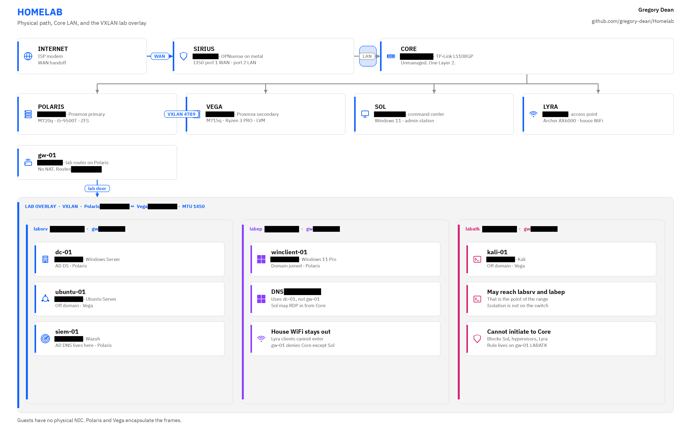

# Homelab

This is a full guide with detailed documentation of the 10 inch homelab I've built. Currently my stack is OPNsense for the firewalls and Proxmox nodes for hosting my VMs.

I use this for all cybersecurity related projects and some personal projects like self hosting or game servers.

<picture>
  <source media="(prefers-color-scheme: dark)" srcset="images/diagrams/topology-dark.png">
  
</picture>

The switch in this cabinet is unmanaged, so it can't do VLANs. Everything plugged into it shares one flat network, and the edge firewall never sees traffic between two devices on that switch. To keep the lab separate from the rest of the house I run a VXLAN overlay between the two Proxmox nodes and a second OPNsense install that only routes the lab. The first firewall gets the house onto the internet. The second one keeps the lab, including the attack box, away from the house network.

## Hosts

> Addresses in this table are examples (`*.lan` names), not the live lab.

| Name | Device | Role | Address |
| ---- | ------ | ---- | ------- |
| Sirius | M720q i5-8400T | OPNsense, physical edge | `sirius.home.lan` |
| Polaris | M720q i5-9500T | Proxmox, primary | `polaris.home.lan` |
| Vega | M715q Ryzen 3 PRO 2200GE | Proxmox, secondary | `vega.home.lan` |
| Sol | Ryzen 7 5800X desktop | Command center | `sol.home.lan` |
| Lyra | Archer AX6000 | Access point | `lyra.home.lan` |
| gw-01 | VM on Polaris | OPNsense, lab router | `gw-01.home.lan` |
| dc-01 | VM on Polaris | AD DS | `dc-01.lab.lan` |
| winclient-01 | VM on Polaris | Windows 11 Pro, domain joined | `winclient-01.lab.lan` |
| siem-01 | VM on Polaris | Wazuh | `siem-01.lab.lan` |
| ubuntu-01 | VM on Vega | Ubuntu Server, off domain | `ubuntu-01.lab.lan` |
| kali-01 | VM on Vega | Kali, off domain | `kali-01.lab.lan` |

## Docs

The docs describe the lab as it exists right now: what I bought, how it's addressed, and why the network is shaped the way it is.

- [Architecture](docs/architecture.md)
- [Hardware](docs/hardware.md)
- [Network](docs/network.md)

## Guides

The guides are how I'd build this again, written so you can follow along on your own hardware. The names and part numbers in this README are what I actually run. The guides use placeholders so they aren't tied to my desk.

- [Lab layout](guides/layout.md)
- [Firewall](guides/firewall.md)
- [Hypervisor](guides/hypervisor.md)
- [Access point](guides/access-point.md)
- [Command center](guides/command-center.md)
- [Lab guests](guides/lab-guests.md)
